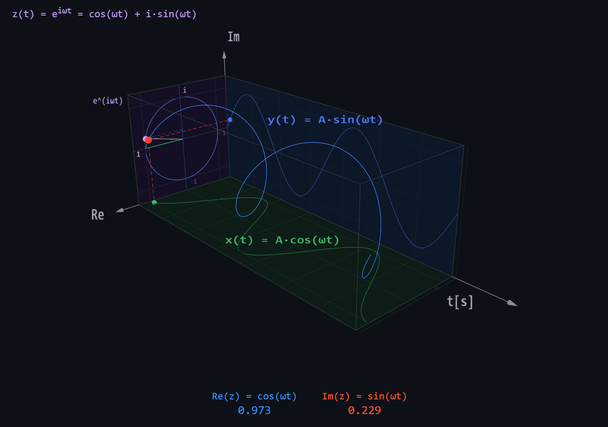

## Hi

  

You might be wordering what kind of nerdy things i hide here, but as disappointing it may sound, I'm not that smart enough to create miraculous firmware or complex software, very much to the contrary. Most of what i've put on here are very simple projects, usualy built with python, other than some notes from courses or tecnical guides i raed throughout my studies and experimentations. 

---

As one of my favorite topics on eletrical engineering, the behavior of alternating current is ilustrated in the following animation. It was for me, one of the most complex topics i had to study throughout my graduation, although certainly, placed in the top interesting ones. As a matter of fact, this equation, also called idenitity of euler, is used to solve problems, before handled with integral and diferencial calculus in the time domain, to much simpler ones in the frequency domain. By the way, if wasn't for it's discovery, we problably woundn't be able to power ours massive cities today.

---
> Math is the language of the universe. So the more equations you know, the more you can converse with the universe.

— Neil deGrasse Tyson

<!---The background color is `#ffffff` for light mode and `#000000` for dark mode.
My [repositories](https://github.com/LucasEduardoSS?tab=repositories)
<!---
LucasEduardoSS/LucasEduardoSS is a ✨ special ✨ repository because its `README.md` (this file) appears on your GitHub profile.
You can click the Preview link to take a look at your changes.
--->
